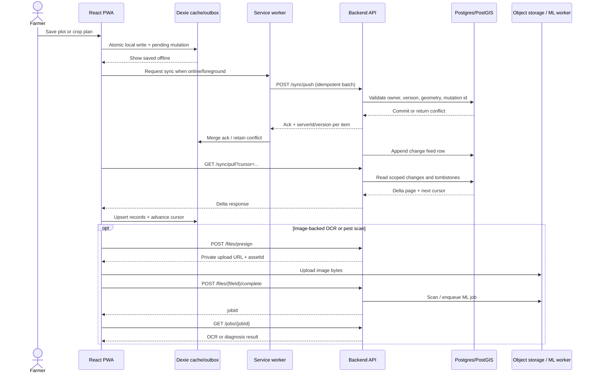

# Field Shift backend integration blueprint

**Reviewed:** 2026-10-31  
**Scope:** Read-only review of the React 19 + Vite + Dexie PWA. This blueprint proposes backend ownership; it does not change application code.

## Executive snapshot

- The app is an offline-capable UI prototype with one real external data client: Open-Meteo forecast and air-quality requests. Weather is cached locally in Dexie.
- Dexie v4 currently defines five stores: plots, cropRules, syncQueue, soilRecords, and weatherCache. The outbox is written by two screens but has no processor, and other local writes bypass it.
- Authentication is a localStorage marker, not an authenticated session. Only /farm and /group use the current guard; role selection is also local and client-controlled.
- Market, pest, soil OCR, land-registry provider results, schemes, dealers, group dashboard metrics, and startup notifications use fixed sample data or artificial delay.
- The requested server data model is larger than the current local schema. This is expected: the current schema is an offline cache, not a normalized server schema.

## 1. Current state inventory

### Local state and backend-owned data

| File and function/component | What it does now | Data in / out | What is mocked or missing |
|---|---|---|---|
| src/db/db.js:4-55, Dexie versions 1-4 | Creates FieldShiftDB and plots, cropRules, syncQueue, soilRecords, and weatherCache stores. | Local JS records; plot/soil rows; queue action/payload; cached weather JSON. | No server ownership, remote sync metadata, conflict state, pest scans, recommendations, preferences, notifications, groups, prices, schemes, dealers, files, or consent table. Only selected keys are indexed. |
| src/components/PlotList.jsx:231, useLiveQuery; :253-286, handleAddPlot | Reads all local plots; adds a plot to IndexedDB and separately appends CREATE_PLOT. | Form name, area/unit, selected crop, map coordinates → plot row plus queue row. | No server request, edit/delete flow, durable media upload, or retry worker. Queue item only has action, payload, status, timestamp and generated local id. |
| src/components/PlotList.jsx:288-327, handleImportProvider | Generic provider path saves only filename, byte count, and “pending review” text in localStorage. Other providers return mock parcels and the handler imports them with bulkAdd. | Provider + country + optional file → local plots or local document metadata. | Document bytes are not uploaded; parcel import is not queued; no registry is contacted. Deduplication is local only. |
| src/components/Recommender.jsx:113-190, runOfflineRotationEngine; :197-198 | Reads plots from Dexie, filters local rules, and calculates ranked crops and illustrative return/savings values. | Plot area, prior crop, season → in-memory recommendation array. | Hardcoded rules, returns, savings, scores and explanatory copy; no recommendation request or saved recommendation record. |
| src/components/Recommender.jsx:275-293, handleAddDemoPlot; :334-363, handleSelectCrop | Seeds an “East Canal Block” demo plot locally; selected rotation is appended to syncQueue. | Demo plot or chosen crop/season/previous crop/estimates → local row/queue item. | Demo data is not clearly separated from real local data; selected plan has no server acknowledgement/version. |
| src/components/SoilImport.jsx:17-30, LATERITE_PROFILE/LATERITE_TIPS; :244-305, handleFile/handleSubmit | Upload control previews an image in memory, waits 1.8 seconds, fills a sample soil card, and saves metrics to Dexie. | Browser File → object URL and nutrient form → soil row. | OCR is simulated; image bytes are not uploaded/retained; saved row has plotId null. The sample is explicitly Goan laterite. |
| src/components/PestScanner.jsx:23-78, DISEASE_RESULTS; :263-280, handleFile | Accepts an image, creates a local object URL, waits 2.2 seconds, and cycles through two fixed diagnoses. | Browser File → preview → disease card; no persistent record. | No image upload, inference, scan history, crop/plot association, confidence provenance, or server-side treatment review. |
| src/services/weather.js:4-5, :40-72, fetchWeather/getCachedWeather | Calls Open-Meteo forecast and air-quality APIs directly, normalizes condition/advisory keys, and writes one cache row. | Plot boundary/coordinates or browser location → provider JSON, derived advisories, IndexedDB cache. | Real network I/O, not a mock. No backend proxy, user-level cache, expiry policy, or provider attribution. Cache id is global (“dashboard-weather”), so forecasts for different plots overwrite one another. |
| src/services/mockEngine.js:52-92, getMockStartupNotifications | Supplies four sample market/weather/plot notifications. | No request → fixed notification objects. | Fixed content is not tied to user, location, actual market data, or weather. |
| src/services/mockEngine.js:117-166; src/components/Recommender.jsx:303-331 | Fixed six-step loading labels with 800 ms intervals, then runs the local recommendation engine after TOTAL_MOCK_DELAY_MS. | Local form values → timer-driven progress and calculation. | Simulates processing; it is not request latency or genuine server progress. |
| src/services/mockEngine.js:171-221, importAgriStackPlots | Waits 1.5 seconds then returns three fixed Goa parcels. | No provider request → sample plot-shaped objects. | Mock only; no call sites found. Active import uses provider.fetchVerifiedParcels instead. |
| src/services/landRegistry/mockProviders.js:1-29, :42-88; registry.js:1-43 | Defines country/provider names, sample polygon centers, isAvailable() => true, and fake parcels returned after 1.2 seconds. | Country → provider metadata → generated parcel objects. | Every listed provider has authMethod mock. example.org registry URLs are placeholders. No OAuth, consent callback, agency API, or verification occurs. |
| src/services/landRegistry/registry.js:3-20 | Reads/writes selected country in localStorage; defaults to IN. | Country code ↔ fieldshift-country. | Device-local, not profile data. |
| src/components/MarketInsights.jsx:23-98, :101-110, :257-269 | Filters six hardcoded market rows and derives a summary from sample prices. Refresh waits 900 ms only. | No request → crop price/variety/market/grade/weekData and derived text. | “Live rates” is not backed by a live feed; no market date, currency normalization, source, cache, or actual refresh. |
| src/services/mockEngine.js:313-319 | Provides a second four-row market-price dataset. | Static price rows. | Mock only. It differs from the six rows rendered by MarketInsights. |
| src/components/PlotList.jsx:44-88, ALERTS/MARKET_TRENDS | Renders fixed alerts and weekly/monthly sparkline values on farm dashboard. | No request → sample alerts and market trends. | Not generated from soil, weather, or prices. |
| src/components/SchemesHub.jsx:7-41, :48-51 | Displays three scheme cards and derives verified plot count from Dexie. | Local plot verification flags → count; fixed scheme metadata → cards. | Scheme eligibility/status/action labels are illustrative, not verified against government records. |
| src/components/DealerDirectory.jsx:5-36, :49-59 | Searches three fixed dealers and stock labels in memory. | Query → filtered static rows. | No coordinates, phone values, stock feed/timestamp, distance calculation, or backend. Action link is a generic Google Maps search at :115. |
| src/components/GroupDashboard.jsx:13-51, :58-145 | Displays five sample farmers, static FPO name, four KPIs, and fixed “40 on track / 2 need attention” copy. | No request → fabricated aggregate and farmer rows. | No group/membership model, farmer authorization, paging, filters, or server aggregation. |
| src/components/StartupNotifications.jsx:70-77, :152-185 | Uses a sessionStorage once-per-session flag, stages mock notifications, displays them with delays, and auto-dismisses. | sessionStorage boolean + mock array → transient toasts. | No notification endpoint, read state, push subscription, or delivery history. |
| src/components/auth/Login.jsx:112-139 | Validates email/password in browser, waits 800 ms, stores {email} as fieldshift-user, navigates to /farm. | Email/password → local JSON marker. | No credential check, user, session, token, OTP, or server error handling. |
| src/components/auth/SignUp.jsx:138-168 | Validates name/contact/password in browser, waits 900+600 ms, then navigates to /farm. | Name/contact/password → success animation only. | No account is created and no auth marker is set. |
| src/components/auth/ForgotPassword.jsx:48-64 | Accepts phone/email, waits 900 ms, and displays success. | Contact → success UI. | No reset request, OTP, or password reset. |
| src/App.jsx:121-161, ProtectedRoleRoute/AppShell | Checks only whether fieldshift-user exists for /farm and /group. Recommender, soil, market, pest, schemes, and settings are not guarded. | Presence of client-editable localStorage key → route decision. | No session validation or server authorization; /group is not role-gated by the guard. |
| src/context/RoleContext.jsx:4-20; src/App.jsx:63-80, :131-136 | Stores farmer/extension selection in localStorage and exposes a visible role switcher. | Client role enum → browser preference and UI route switch. | Not a server-issued permission. No admin role exists in context. |
| src/context/LanguageContext.jsx:6-10, :35-49, :126-149 | Loads bundled translation JSON chunks, detects browser language, persists language/recent languages, and injects Google Fonts for scripts. | Browser/selected locale → locale bundle and local preferences. | No translation API call. Locale bundles live under src/locales. |
| src/context/ThemeContext.jsx:4-32 | Persists system/light/dark theme in localStorage and reads legacy field-shift-theme. | Theme ↔ localStorage. | Device-only preference. |
| src/components/Settings.jsx:233-239, :300-318 | Keeps sowing/fertilizer and SMS/WhatsApp toggles only in React state; watches navigator.onLine; logout clears localStorage/sessionStorage. | Toggle state/browser online state → transient UI; logout → clears browser keys. | Preferences are not persisted or sent. Channels do not subscribe/register messaging. No Notification API is used. |
| src/components/WeatherPanel.jsx:9-10, :16-54 | Selects local plot, requests weather service, falls back to stale Dexie cache, stores units in localStorage. | Plot → weather client; units ↔ localStorage. | Per-user preference is not synced. |
| src/components/InstallPrompt.jsx:23-75 | Stores install banner dismissal in localStorage. | Dismissal boolean → browser storage. | Device UI state; do not sync unless product wants cross-device dismissal. |
| src/components/FieldMapper.jsx:128-164; src/components/DashboardMap.jsx:13-96 | Draw/edit map vertices in local component state and render plot boundaries. | Geolocation, drawn vertices, local plots → map and area calculation. | Geometry is not server-validated. Both map layers use direct Google tile URLs in Leaflet. |
| src/components/CropPicker.jsx; src/data/crops.js:1-95; src/locales/* | Uses static crop definitions and translation keys with bundled locale data. | Crop id/query → local catalog and localized label. | Crop catalog/facts are static; no API or server versioning. |
| src/hooks/useVoice.js:9-48, :86-214; src/components/VoiceAdvisory.jsx:5-30 | Uses browser SpeechSynthesis and locally available voices; chunks text and handles fallback. | Text + locale → device speech playback. | No audio/TTS provider request. Voice availability varies by browser/device. |
| src/components/AgriStackConsentModal.jsx:7-99 | Contains consent-shaped modal with requested data list and invokes onImport. | Click → supplied callback. | No call site found in src; active flow is LandRegistryConsentModal. |
| src/components/LandRegistryConsentModal.jsx:10-75 | Collects country/file selection, saves country locally, calls PlotList import handler. | Country + optional File → callback. | UI consent is not a durable consent receipt or agency OAuth flow. |
| src/components/AddPlotModal.jsx:18-82; src/components/CatchCropAlert.jsx:6-49; src/components/VerificationBadge.jsx:4-20 | AddPlotModal collects form data; CatchCropAlert is local dismissal/navigation; badge displays a supplied flag. | User-entered plot/map data or local click state. | Modal does not call API; a UI badge cannot establish verification. |
| src/components/LandingPage.jsx, src/components/NotFound.jsx, src/layouts/AuthLayout.jsx | Landing/auth shell/not-found presentation; route wiring is in App. | Navigation and static copy. | No backend data flow. |
| vite.config.js:21-125 | Configures PWA autoUpdate, precache, and runtime caching. API rule matches HTTPS URLs under /api/v1 using StaleWhileRevalidate. | Static build assets and matching network responses → Cache Storage. | No Background Sync queue/handler. Current Open-Meteo URLs do not match backend API rule. Do not indiscriminately cache auth/user-specific responses. |

### Storage and network findings

**localStorage keys found:** fieldshift-user (src/components/auth/Login.jsx:137; read by src/App.jsx:122), fieldshift-role (src/context/RoleContext.jsx:4-17), fieldshift-theme and legacy field-shift-theme (src/context/ThemeContext.jsx:4-9, :31), fieldshift-language and fieldshift-recent-languages (src/context/LanguageContext.jsx:6-7, :36-45, :142-146), fieldshift-country (src/services/landRegistry/registry.js:3, :15-20), fieldshift-land-document (src/components/PlotList.jsx:291), fieldshift_installDismissed (src/components/InstallPrompt.jsx:23, :32, :74), and fieldshift-weather-units (src/components/WeatherPanel.jsx:9, :23, :53). Settings clears all localStorage at src/components/Settings.jsx:312-316.

**sessionStorage keys found:** fieldshift_recommenderCached in src/services/mockEngine.js:365-395 (helpers are not referenced by Recommender; loading still uses timers); fieldshift_startupNotifShown in src/components/StartupNotifications.jsx:70-77. Settings clears sessionStorage at src/components/Settings.jsx:314-315.

**IndexedDB:** src/db/db.js:7-55 defines plots (auto id; serverId/name/area/village/providerId/externalId indexed), cropRules (id/cropFamily/duration/nitrogenEffect/waterNeed), syncQueue (auto id/action/status/timestamp), soilRecords (auto id/plotId/ph/nitrogen/phosphorus/potassium/timestamp), and weatherCache (id/updatedAt). PlotList adds/reads plots and queue; Recommender reads plots, inserts demo plot, and queues rotation; SoilImport adds soilRecords; weather writes/reads weatherCache; SchemesHub reads plots. cropRules is defined but has no read/write call site found.

**Weather location caveat:** `getCentroid` averages the boundary vertices, which is not a reliable polygon centroid for irregular or concave plots (src/services/weather.js:7-17). If geolocation is unavailable, the code falls back to `[20,0]` (src/services/weather.js:42-49); do not persist or present a forecast for that fallback as the farmer's location.

**Timer audit:** artificial data/processing latency is 800 ms in Login (src/components/auth/Login.jsx:136), 900 ms + 600 ms in SignUp (:164-166), 900 ms in ForgotPassword (src/components/auth/ForgotPassword.jsx:61), 1,500 ms in unused importAgriStackPlots (src/services/mockEngine.js:172), 1,200 ms in every mock registry provider (src/services/landRegistry/mockProviders.js:51-53), 1,800 ms for fake OCR (src/components/SoilImport.jsx:253-260), 2,200 ms for fake pest scan (src/components/PestScanner.jsx:270-280), and 900 ms for market refresh (src/components/MarketInsights.jsx:265-269). Recommendation progress uses six 800 ms steps and waits TOTAL_MOCK_DELAY_MS (src/services/mockEngine.js:117-166; src/components/Recommender.jsx:317-331): the current arithmetic is 4,800 ms, although the comment at mockEngine.js:166 says 3,000 ms. Other timeouts are UI scheduling, not fake backend latency: map resize/fit (FieldMapper.jsx:66; DashboardMap.jsx:34-55), map-result handoff (AddPlotModal.jsx:58-63), toast/reset timers (PlotList.jsx:293, :326; Recommender.jsx:270-272; SoilImport.jsx:298; Settings.jsx:308), startup notification stagger/auto-dismiss (StartupNotifications.jsx:168-180), initial weather effect deferral (WeatherPanel.jsx:45-48), and speech voice polling (useVoice.js:112-124).

**Explicit fetch/axios audit:** no Axios import/client found. The only application fetch calls are GET requests in src/services/weather.js:60 to https://api.open-meteo.com/v1/forecast and https://air-quality-api.open-meteo.com/v1/air-quality, with coordinates and requested weather/air variables. Other external resources are Google Fonts (src/index.css:1; src/context/LanguageContext.jsx:118), direct Google map tile URLs (src/components/FieldMapper.jsx:186; src/components/DashboardMap.jsx:90), and a generic Google Maps link (src/components/DealerDirectory.jsx:115). No root .env or .env.* file was present during review. package.json has no API/query client, schema validator, or TanStack Query dependency (package.json:1-34).

### Screen and modal audit

| Route/screen or modal | Backend responsibility to introduce | Frontend call site |
|---|---|---|
| /, landing and auth shell | No landing data; account operations on auth screens. | src/App.jsx:143-160; src/components/LandingPage.jsx:6; src/layouts/AuthLayout.jsx:153 |
| /farm, farmer dashboard | Plots, weather, notifications, market summary/alerts, dealers. | src/components/PlotList.jsx:216-327, :331-462; WeatherPanel and StartupNotifications children. |
| /farm or /group, extension dashboard | Group/farmer directory and server-computed KPIs. | src/components/GroupDashboard.jsx:13-145; App.jsx:148-149. |
| /recommender | Plot/crop-rule reads, recommendation generation, saved crop plan. | src/components/Recommender.jsx:192-198, :303-363. |
| /soil | Upload, OCR job, review/correction and soil record CRUD. | src/components/SoilImport.jsx:244-305. |
| /market | Filtered/cached price rows and refresh. | src/components/MarketInsights.jsx:257-269. |
| /pest | Image upload, asynchronous classification, scan history. | src/components/PestScanner.jsx:263-280. |
| /schemes | Scheme catalog, eligibility against user/verified plots. | src/components/SchemesHub.jsx:7-51. |
| /settings | Profile/preferences, notification consent/subscriptions, logout. | src/components/Settings.jsx:228-318. |
| /login | Unified phone + 6-digit SMS OTP login and new-farmer sign-up (`/signup` and `/forgot-password` redirect to `/login`). | src/components/auth/Login.jsx; src/context/AuthContext.jsx; src/api/auth.js. |
| AddPlotModal and FieldMapper | Local draft only; parent should call create plot and enqueue offline writes. | AddPlotModal.jsx:34-82; FieldMapper.jsx:147-195; PlotList.jsx:253-286. |
| LandRegistryConsentModal | Provider discovery, durable consent, OAuth/OTP redirect, parcel import. | LandRegistryConsentModal.jsx:10-75; PlotList.jsx:288-327. |
| AgriStackConsentModal | Legacy-looking, currently unreferenced; consolidate with active consent flow if retained. | AgriStackConsentModal.jsx:7-99. |
| StartupNotifications, DealerDirectory, WeatherPanel, DashboardMap | Notification/dealer/weather data; map draws cached Plot geometry. | StartupNotifications.jsx:152-185; DealerDirectory.jsx:49-59; WeatherPanel.jsx:16-54; DashboardMap.jsx:61-96. |
| CatchCropAlert, VoiceAdvisory, CropPicker, CropImage, VerificationBadge, InstallPrompt | Mostly UI/device capabilities; crop catalog/verified plot data needs an API-backed source. | src/components/CatchCropAlert.jsx:6-49; src/components/VoiceAdvisory.jsx:5-30; src/components/CropPicker.jsx:7-53; src/components/CropImage.jsx:13-66; src/components/VerificationBadge.jsx:4-25; src/components/InstallPrompt.jsx:23-75. |
| NotFound | No backend ownership. | src/components/NotFound.jsx |

## 2. Data models

### Conventions and current schema alignment

Use UUIDs for server ids, UTC timestamps, decimal numbers (not formatted strings) for quantities, explicit units, and nullable fields only where missing data is allowed. Scope user-owned records by owner_id. Standardize boundaries as GeoJSON WGS84 [longitude, latitude].

Dexie v4 is an offline cache, not the canonical schema (src/db/db.js:4-55). Existing plot coordinates are arrays of [latitude, longitude] (src/components/FieldMapper.jsx:23-31; src/components/PlotList.jsx:264-265, :308-310); convert at the API boundary to GeoJSON [longitude, latitude]. Plot area and timestamps use mixed strings/numbers and need normalization. Migration should retain local primary keys as localId, add serverId, ownerId, version, updatedAt, deletedAt and syncState, and add indexes for retries/account-scoped reads. Do not trust a client isVerified flag.

Role means authorization assignment. Current browser context only supports farmer and extension (src/context/RoleContext.jsx:7-17); admin is proposed server-only. A user may have multiple scoped roles.

### Entity definitions

Required/optional refers to the proposed server contract. Dexie columns are current shape, not necessarily server field names.

| Entity | Fields (type; required / optional) | Relationships and Dexie alignment |
|---|---|---|
| User | id UUID (R); phoneE164 string (R, unique E.164); displayName string (O while pending, R when active); status active/pending/disabled (R); countryCode ISO alpha-2 (R); preferredLocale string (R); smsOptInAt/privacyAcceptedAt timestamps (O); createdAt/updatedAt timestamp (R); lastLoginAt timestamp (O). | Has roles, preferences, plots, notifications, scans, soil records, groups and consent. Authenticated exclusively via phone OTP (`POST /auth/otp/request` and `POST /auth/otp/verify`); no email or password fields exist. |
| Role | code farmer/extension/admin (R); label string (R); scope global/group (R); permissions string[] (R). | Many-to-many UserRole. Group-scoped extension rights belong on membership, not client state. |
| Plot | id UUID (server R); localId string/number (O); ownerId UUID (R); name string (R); area numeric (R); areaUnit acre/hectare/guntha/sqm/sqft (R); areaHectares numeric (R); village string (O); primaryCropId/intercropId UUID/string (O); boundary GeoJSON Polygon/MultiPolygon (O for unmapped manual plot); isVerified boolean (R); source manual/in-agristack/provider (R); providerId/parcelRef/externalId strings (O); verifiedAt timestamp (O); provenance JSON (O); version integer (R); createdAt/updatedAt/deletedAt timestamps (R/R/O). | Belongs to User; has seasons, soil, recommendations, scans and optional registry parcel. Dexie indexes at db.js:10, :23, :32, :50; area is string and boundaries are arrays. v3 migration normalizes provenance at :36-47. |
| Crop | id string (R); family string/enum (R); emoji string (O); defaultSeason enum (O); rootDepth shallow/medium/deep (O); waterNeed numeric/string (O; catalog uses numbers, recommender rules use labels); thumbUrl/cardUrl strings (O); nameKey/localNameKey strings (O); localized names JSON (O); active boolean (R). | Referenced by plots, seasons, rules, recommendations/prices. Static fields at src/data/crops.js:1-75; Dexie primaryCrop is free text. |
| Season | id UUID/string (R); code Rabi/Kharif/Zaid (R); displayName string (R); startsOn/endsOn date or month/day (O); regionCountryCode/stateCode (O); year integer (R). | Has assignments/recommendations. Recommender uses strings and labels only (Recommender.jsx:366-370); no Dexie table. |
| PlotSeason assignment | id UUID (R); plotId UUID (R); seasonId/code (R); cropId UUID/string (R); previousCropId/string (O); status planned/active/harvested/cancelled (R); plannedAt/updatedAt timestamps (R); areaHectares numeric (O); sourceRecommendationId UUID (O); version integer (R). | Joins Plot, Season, Crop, optional Recommendation. Current choice is queue payload only (Recommender.jsx:334-357). |
| SoilRecord | id UUID (server R); localId string/number (O); ownerId UUID (R); plotId UUID nullable (O); ph numeric nullable (O); nitrogen/phosphorus/potassium numeric nullable (O, kg/ha); organicCarbon numeric nullable (O, percent); ec numeric nullable (O, dS/m); sampledAt timestamp (O); source manual/ocr/import (R); assetId UUID (O); ocrStatus/ocrConfidence 0-1 (O); version/createdAt/updatedAt/deletedAt (R/R/R/O). | User, optional Plot/FileAsset. Dexie indexes plotId/ph/N/P/K/timestamp (db.js:28, :53); UI writes organicCarbon/ec/hasPhoto/timestamp and plotId null (SoilImport.jsx:286-295). |
| Recommendation | id UUID (R); ownerId UUID (R); plotId UUID (R); seasonId/code (R); previousCropId/string (O); requestInputs JSON (R); ranked results (R); modelVersion string (R); generatedAt timestamp (R); selectedCropId (O); status generated/selected/expired (R); version (R). Item: cropId, rank integer, score numeric, reason string, estimatedNetReturn/currency, baselineReturn, fertilizerReductionKg, waterSavingsPct. | User/Plot/Season; items reference Crop; selected plan may create PlotSeason. Current result is React state and local rules (Recommender.jsx:113-190, :207-210). |
| CropRule | id string/UUID (R); cropId (O); cropFamily string (R); rootDepth enum (O); seasons string[] (R); durationDaysMin/Max integer (O); waterNeed numeric/enum (O); baseReturnPerHectare/fertilizerReductionPerHectare numeric (O); fertilizerName (O); waterSavingsPct/soilHealthScore numeric (O); country/state/soil conditions (O); ruleVersion/updatedAt (R). | Usually references Crop. Dexie indexes cropFamily/duration/nitrogenEffect/waterNeed (db.js:13, :24, :33, :51), but no use found. Reconcile nitrogenEffect with local ureaReductionPerHectare. |
| PestScan | id UUID (R); ownerId UUID (R); plotId UUID nullable (O); assetId UUID (R); cropId/string (O); status queued/processing/done/failed (R); diseaseCode/name (O); confidence 0-1 (O); severity enum (O); description/advice JSON by locale (O); modelVersion (O); reviewedBy/reviewedAt (O); createdAt/updatedAt (R). | User, optional Plot/FileAsset/model output. No Dexie store/history; current results are fixed objects (PestScanner.jsx:23-78). |
| MarketPrice | id UUID (R); countryCode/stateCode/district/market strings (R/O); cropId/string and variety (R/O); grade (O); minPrice/maxPrice/modalPrice numeric (O); unit/currency ISO-4217 (R); observedOn date (R); source/fetchedAt (R); rawSourceId (O). | Crop optional; natural key may include market/crop/variety/unit/date/source. No local table; samples differ between PlotList and MarketInsights. |
| Scheme | id UUID/string (R); countryCode (R); name/focus/description strings (R); benefit/eligibility JSON (O); per-user status/eligibility (O); application/document/source URLs (O); validFrom/validTo dates (O); updatedAt (R). | Catalog by country; eligibility may depend on User/Plot/SoilRecord. Three hardcoded cards include unverified labels (SchemesHub.jsx:7-41). |
| Dealer | id UUID (R); name (R); phone/address/country/state/district/village (O); location geography Point (O); stockItems array or normalized DealerStock (O); inventoryUpdatedAt/source (O); active boolean (R). | Stock references Dealer and optional input product/crop. Distance is derived; do not store “8 km away”. Three static rows (DealerDirectory.jsx:5-36). |
| Notification | id UUID (R); userId UUID (R); type/title/body (R); icon/severity/locale (O); data JSON (O); createdAt (R); readAt/dismissedAt/expiresAt (O); deliveryChannels string[] (O). | User; optional entity reference in data. Mock lacks owner/read state/time (mockEngine.js:52-92). |
| Preference | userId UUID (R); locale/theme system/light/dark (R); area/temperature/wind/precipitation units (O); sowingReminder/fertilizerReminder booleans (O); notificationChannels enum[] (O); updatedAt (R). | One-to-one User. Theme/language/units use localStorage; reminders in memory (ThemeContext.jsx:4-32; LanguageContext.jsx:6-7, :142-149; WeatherPanel.jsx:9-10, :50-54; Settings.jsx:233-239). Keep install dismissal/recent-language history device-local unless requested. |
| SyncQueue item | local id integer/string (R); clientMutationId UUID (R); entityType (R); entityLocalId (O); operation create/update/delete (R); payload JSON (R); baseVersion integer (O); status pending/inFlight/failed/conflict/acked (R); attempts/nextAttemptAt (O); attachmentIds UUID[] (O); createdAt (R); lastError JSON (O). | Device outbox; server applies canonical entity and appends change. Current has only auto id/action/status/timestamp plus ad hoc payload (db.js:16, :25, :34, :52; PlotList.jsx:277-282; Recommender.jsx:341-357). |
| FPO/Group | id UUID (R); name/country/state/district (R/O); registrationRef (O); createdAt/updatedAt (R); active boolean (R). GroupMembership: id/groupId/userId UUID (R); membershipRole owner/admin/extension/member (R); status invited/active/suspended (R); joinedAt/createdAt (O/R); permissions string[] (O). | Group has users through membership. No tables; FPO/farmers/KPIs are constants (GroupDashboard.jsx:13-51, :67-75, :97-110). |
| Weather cache | cacheKey string (R); location Point or lat/lon (R); plotId UUID (O); provider (R); fetchedAt/expiresAt (R); payload JSON (R); attribution/schemaVersion (O/R). | Cache by plot or geohash, not one shared key. Dexie only indexes id/updatedAt and stores JSON (db.js:54; weather.js:3, :64-71). |
| LandRegistryParcel | id UUID (R); providerId/countryCode/parcelRef (R); ownerId UUID (R); geometry GeoJSON (R); areaHectares (O); landUse/cropDeclared (O); ownerStatus owner/tenant/unknown (O); source (R); isVerified (R); verifiedAt/registryUrl (O); importedPlotId/rawProviderRef (O). | Owner/provider; may import to Plot. Type described in src/services/landRegistry/types.js:12-25 and mock built at mockProviders.js:55-68; no parcel store exists. |
| LandRegistryConsent | id/userId UUID (R); providerId/countryCode (R); scopes/purpose/status (R); providerConsentRef/grantedAt/revokedAt/expiresAt (O); noticeVersion/evidence JSON/createdAt/updatedAt (R). | User/provider and parcels. Required for audit but absent locally; modal click is not a receipt. |
| FileAsset | id/ownerId UUID (R); objectKey/mimeType/purpose/status (R); sizeBytes integer (R); sha256 (O); createdAt (R). | Referenced by SoilRecord, PestScan, consent/documents. Current Files are previews or metadata only. |

### Illustrative JSON records

Required/optional fields above define contract; these representative examples use shortened UUIDs.

- User: {"id":"8d3b…","displayName":"Asha Naik","phoneE164":"+919876543210","status":"active","countryCode":"IN","preferredLocale":"kok","createdAt":"2026-10-31T05:00:00Z"}
- Role: {"code":"extension","scope":"group","permissions":["groups:read","farmers:read"]}
- Plot: {"id":"a904…","ownerId":"8d3b…","name":"North Field","area":1.42,"areaUnit":"hectare","areaHectares":1.42,"boundary":{"type":"Polygon","coordinates":[[[73.8,15.5],[73.81,15.5],[73.81,15.51],[73.8,15.5]]]},"isVerified":false,"source":"manual","version":1}
- Crop: {"id":"rice","family":"cereal","defaultSeason":"Kharif","rootDepth":"shallow","waterNeed":3,"nameKey":"crops.rice.name","localNameKey":"crops.rice.localName","active":true}
- Season: {"id":"IN-GA-KHARIF-2026","code":"Kharif","displayName":"Kharif 2026","year":2026,"regionCountryCode":"IN"}
- SoilRecord: {"id":"c1a…","ownerId":"8d3b…","plotId":null,"ph":5.5,"nitrogen":140,"phosphorus":18,"potassium":210,"organicCarbon":0.62,"ec":0.28,"source":"manual","createdAt":"2026-10-31T05:00:00Z"}
- Recommendation: {"id":"rec-1","plotId":"a904…","seasonCode":"Rabi","modelVersion":"rotation-v1","generatedAt":"2026-10-31T05:00:00Z","results":[{"cropId":"chickpea","rank":1,"score":96,"reason":"Fits the rotation.","estimatedNetReturn":120000,"currency":"INR","fertilizerReductionKg":86,"waterSavingsPct":45}]}
- CropRule: {"id":"chickpea-rabi-v1","cropId":"chickpea","cropFamily":"legume","seasons":["Rabi"],"durationDaysMin":100,"durationDaysMax":110,"waterNeed":"low","ruleVersion":"v1","updatedAt":"2026-10-31T05:00:00Z"}
- PestScan: {"id":"scan-1","assetId":"file-1","status":"done","cropId":"paddy","diseaseCode":"leaf-blight","confidence":0.94,"severity":"moderate","modelVersion":"plant-v1","createdAt":"2026-10-31T05:00:00Z"}
- MarketPrice: {"id":"price-1","countryCode":"IN","stateCode":"GA","market":"Mapusa","cropId":"cashew","variety":"Raw","modalPrice":8400,"unit":"quintal","currency":"INR","observedOn":"2026-10-30","source":"AGMARKNET","fetchedAt":"2026-10-31T05:00:00Z"}
- Scheme: {"id":"pm-kisan","countryCode":"IN","name":"PM-KISAN","focus":"Income support","benefit":{"amount":6000,"currency":"INR","period":"year"},"updatedAt":"2026-10-31T05:00:00Z"}
- Dealer: {"id":"dealer-1","name":"Mapusa Krishi Kendra","location":{"type":"Point","coordinates":[73.81,15.59]},"stockItems":[{"label":"Ragi Seeds","availability":"in_stock"}],"active":true}
- Notification: {"id":"notif-1","userId":"8d3b…","type":"weather","title":"Rain expected","body":"Check the forecast before spraying.","severity":"warning","createdAt":"2026-10-31T05:00:00Z","readAt":null}
- Preference: {"userId":"8d3b…","locale":"kok","theme":"system","areaUnit":"acre","temperatureUnit":"C","notificationChannels":["push"],"sowingReminder":true,"fertilizerReminder":false,"updatedAt":"2026-10-31T05:00:00Z"}
- SyncQueue: {"clientMutationId":"9a5…","entityType":"plot","entityLocalId":12,"operation":"create","payload":{"name":"North Field","areaHectares":1.42},"status":"pending","attempts":0,"createdAt":"2026-10-31T05:00:00Z"}
- Group/membership: {"id":"fpo-1","name":"Dicholi Cooperative Society","countryCode":"IN","active":true}; {"groupId":"fpo-1","userId":"8d3b…","membershipRole":"extension","status":"active"}
- Weather cache: {"cacheKey":"plot:a904:hourly-v1","plotId":"a904…","provider":"open-meteo","fetchedAt":"2026-10-31T05:00:00Z","expiresAt":"2026-10-31T06:00:00Z","payload":{"latitude":15.59,"longitude":73.81}}
- LandRegistryParcel: {"id":"parcel-1","providerId":"in-agristack","countryCode":"IN","parcelRef":"145/2A","ownerId":"8d3b…","geometry":{"type":"Polygon","coordinates":[[[73.8,15.5],[73.81,15.5],[73.81,15.51],[73.8,15.5]]]},"areaHectares":1.8,"source":"in-agristack","isVerified":true}
- LandRegistryConsent: {"id":"consent-1","userId":"8d3b…","providerId":"in-agristack","countryCode":"IN","scopes":["parcel boundary"],"purpose":"Import verified fields","status":"initiated","noticeVersion":"2026-01","createdAt":"2026-10-31T05:00:00Z"}
- FileAsset: {"id":"file-1","ownerId":"8d3b…","objectKey":"private/8d3b/soil/file-1","mimeType":"image/jpeg","sizeBytes":482000,"purpose":"soil-card","status":"uploaded","createdAt":"2026-10-31T05:00:00Z"}

## 3. API endpoint catalogue

Base path: /api/v1. Use JSON except signed uploads. Lists use cursor pagination (limit default 25, max 100, nextCursor) and filters. Return server ids/version/updatedAt and stable error envelope {error:{code,message,requestId,details}}. Common statuses: 400 malformed, 401 unauthenticated, 403 forbidden, 404 missing/hidden, 409 conflict, 413 too large, 415 unsupported type, 422 validation/business rule, 429 rate limit, 500 unexpected, 503 provider/job unavailable. Tenant-scope every request.

| Feature and endpoint | Auth | Request → response | Filters/errors | Screen and frontend replacement |
|---|---|---|---|---|
| POST /auth/otp/request; POST /auth/otp/verify | Public | Request `{phoneE164,purpose:'login',channel?,locale?}` → `{challengeId,expiresInSeconds,resendAfterSeconds,voiceAvailable}`; verify `{challengeId,phoneE164,code,profile?}` → `{user,csrfToken,isNewUser}` + HttpOnly cookies. | 400/422 bad code (`otp_invalid`), 410 expired (`otp_expired`), 429 throttled (`otp_attempts_exceeded`, `rate_limited`). | Unified `/login` flow in `src/components/auth/Login.jsx` via `src/api/auth.js` and `src/context/AuthContext.jsx`. |
| POST /auth/refresh; POST /auth/logout | Refresh/session cookie | Refresh rotates cookies and returns `{user,csrfToken}`; logout revokes session and clears cookies. | 401 expired/revoked, 429. | `AuthProvider` (`src/context/AuthContext.jsx`), `src/api/client.js`, and `src/components/Settings.jsx`. |
| GET/PATCH /me | Session | GET → User + scoped roles; PATCH `{displayName,preferredLocale,countryCode,smsOptIn,privacyConsent}` → User. | 401/422. | New-user profile step in `Login.jsx` and account card in `Settings.jsx`. |
| GET/PUT /me/preferences | Session | PUT validated Preference → saved Preference. | 401/422. | Theme/Language contexts and Settings; ThemeContext.jsx:16-39; LanguageContext.jsx:126-149; Settings.jsx:233-239. |
| GET/POST /plots; GET/PATCH/DELETE /plots/{plotId} | Session; owner or group scope | POST Plot draft → Plot; PATCH {version,fields} → Plot; DELETE soft-deletes. | q,village,isVerified,source,updatedSince,bbox; 409 conflict. | PlotList reads/handleAddPlot and new edit/delete; PlotList.jsx:231, :253-286. |
| GET/POST /plots/{plotId}/seasons; PATCH /plots/{plotId}/seasons/{assignmentId} | Session + plot/group scope | Create {seasonCode,year,cropId,previousCropId,status,sourceRecommendationId} → assignment. | year/status; 404/409/422. | Recommender.handleSelectCrop; Recommender.jsx:334-363. |
| GET /land-registries/providers | Session | countryCode → {providers:[{id,name,authMethod,available,scopes,requirements}]}. | countryCode; 401/422. | Registry lookup; registry.js:6-13; LandRegistryConsentModal.jsx:10-24. |
| POST /land-registries/consents | Session | {providerId,countryCode,scopes,purpose,noticeVersion,returnUrl} → Consent + optional authorizationUrl. | 403 unavailable, 422 scope, 429. | LandRegistryConsentModal.handleAuthorize; :19-29. |
| POST /land-registries/callbacks/{providerId} | Provider signature/mTLS, never browser auth | Provider code/state → server exchange, consent update and parcel-fetch job. | 401 bad signature, 409 replay, 422 callback. | Server callback; UI polls consent. No current callback. |
| GET /land-registries/consents/{consentId}; GET /land-registries/consents/{consentId}/parcels | Session + owner | Consent state and provider parcels, paginated. | status; 403/404/409. | Replace provider.fetchVerifiedParcels; mockProviders.js:51-69; PlotList.jsx:296-323. |
| DELETE /land-registries/consents/{consentId} | Session + consent owner; CSRF protection | Optional {reason} → 204; revoke locally and enqueue provider revocation where supported. | 403/404/409 already revoked/expired; 422 reason. | New action in LandRegistryConsentModal/Settings; persist durable withdrawal, currently absent. |
| POST /plots/import-land-parcels | Session + granted consent | {consentId,parcelIds[]} → {plots,importedCount,skippedCount}. | Idempotent owner/provider/externalId; 409/422. | PlotList.handleImportProvider; PlotList.jsx:288-327. |
| POST /recommendations; GET /recommendations/{id} | Session + plot/group scope | {plotId,seasonCode,year,previousCropId,soilRecordId?,locale,weatherContext?} → Recommendation + results; can return 202 job. | plotId/season/year/cursor; 409 stale version; 422 inputs. | Replace timer/engine; Recommender.jsx:303-331; mockEngine.js:225-280. |
| GET/POST /soil-records; GET/PATCH/DELETE /soil-records/{id} | Session + plot/group scope | POST measurements/sampleDate/plotId/source/assetId → SoilRecord; PATCH reviewed correction/version. | plotId/from/to; 409 version, 422 range. | SoilImport.handleSubmit; SoilImport.jsx:281-305. |
| POST /soil-records/ocr; GET /jobs/{jobId} | Session + owned asset/job | {assetId,locale,plotId?} → 202 {jobId,status}; job returns OCR fields/confidence/status. | Upload 413/415; unreadable 422; 429/503. | Replace SoilImport.handleFile; SoilImport.jsx:253-262. |
| GET/POST /pest-scans; GET /pest-scans/{id} | Session + asset owner | POST {assetId,plotId?,cropId?,locale} → 202; detail diagnosis/advice/modelVersion. | plotId/status/from/to; 413/415/422/429. | Replace PestScanner.handleFile; PestScanner.jsx:270-280. |
| GET /market/prices | Public or session; rate-limited | No body; {items:[MarketPrice],sourceUpdatedAt}. | countryCode required; state/district/market/cropId/variety/from/to/unit; cursor/limit; 429/503. | Replace MarketInsights and PlotList card; MarketInsights.jsx:23-98, :257-269; PlotList.jsx:71-88. |
| GET /weather/forecast; GET /weather/cache | Session or limited public | lat/lon or plotId, days, locale, units → provider/fetchedAt/stale/current/hourly/daily/advisories/attribution. | Coordinate validation; 422/429/503. | Replace direct fetch in weather.js:40-72; WeatherPanel.jsx:27-43. |
| GET /schemes; GET /schemes/{id}; POST /schemes/{id}/eligibility | Session for eligibility; catalog public | countryCode/cropId/status/locale; eligibility {plotId?} → {eligible,missingRequirements,sourceUpdatedAt}. | Cursor/limit; 404/422/503. | SchemesHub.jsx:7-51. |
| GET /dealers; GET /dealers/{id} | Public or session | lat/lon/radiusKm,inputProduct/cropId,q → items + distanceKm. | Cursor/limit; 422 coordinates, 429. | DealerDirectory.jsx:5-59. |
| GET /notifications; PATCH /notifications/{id}; POST/DELETE /push-subscriptions | Session; notification owner | unread/type/cursor; PATCH {readAt}; POST subscription {endpoint,keys}; DELETE {endpoint}. | Cursor/limit; 401/403/404/409/422. | StartupNotifications.jsx:152-185; Settings.jsx:233-239. |
| GET /groups; GET /groups/{groupId}/dashboard; GET /groups/{groupId}/farmers | Session + membership | Group, aggregate KPIs and paged farmer summaries. | q/village/crop/status; cursor/limit; 403 scope. | GroupDashboard.jsx:58-145. |
| GET /crops; GET /crop-rules | Public cacheable or session | locale/family/season/country/updatedSince → rows + version. | Cursor/limit; ETag/304. | Replace static catalog/rules; crops.js:1-95; Recommender.jsx:113-123. |
| GET /translations/{locale} | Public cacheable | Locale/version/dictionary; optional namespaces. | 404 unsupported; ETag/304. | Keep bundled fallback; LanguageContext.jsx:8-33. |
| POST /files/presign; POST /files/{fileId}/complete | Session | Presign {purpose,mimeType,sizeBytes,sha256?} → private URL/fileId; complete → asset status. Multipart POST /files is MVP alternative. | 413 size, 415 type, 422 checksum, 429. | SoilImport.jsx:246-260; PestScanner.jsx:270-280; PlotList.jsx:288-294. |
| POST /sync/push; GET /sync/pull | Session + device id | Push {deviceId,mutations:[SyncQueueItem]} → per-item ack/conflict/retry; pull cursor/limit → {changes,nextCursor,serverTime}. | Per-item validation; 409 conflict; 413 batch; 429 retryAfter. | New sync engine; current writes PlotList.jsx:276-282; Recommender.jsx:341-357. |

### Request/response examples

- Plot create: {"clientMutationId":"UUID","name":"North Field","area":1.42,"areaUnit":"hectare","areaHectares":1.42,"primaryCropId":"rice","boundary":{"type":"Polygon","coordinates":[[[73.8,15.5],[73.81,15.5],[73.81,15.51],[73.8,15.5]]]}}
- Plot response: {"id":"UUID","ownerId":"UUID","name":"North Field","isVerified":false,"source":"manual","version":1,"createdAt":"2026-10-31T05:00:00Z","updatedAt":"2026-10-31T05:00:00Z"}
- Sync response: {"results":[{"clientMutationId":"UUID","status":"acked","entityType":"plot","entityId":"UUID","version":1},{"clientMutationId":"UUID","status":"conflict","serverVersion":4,"serverRecord":{}}]}
- List response: {"items":[],"nextCursor":null,"limit":25,"sourceUpdatedAt":"2026-10-31T05:00:00Z"}

## 4. Auth and security design

1. **Use short JWT access and rotating refresh cookies.** Access about 5-15 minutes; refresh longer-lived, rotated and revocable. Put both in Secure, HttpOnly, SameSite cookies, not localStorage. Use CSRF token/header on unsafe cookie-authenticated methods. API client uses credentials: include and one shared refresh attempt on 401. Offline, preserve only a device-scoped local session hint; API access requires online refresh.
2. **Phone + 6-digit SMS OTP only (no email or password).** Authentication uses a single unified phone-OTP flow (`POST /auth/otp/request` and `POST /auth/otp/verify`) for both existing users and new-farmer sign-ups. OTP codes are 6 digits, hashed at rest with HMAC-SHA256, valid for 5 minutes (300 seconds), capped at 5 verification attempts per challenge, and throttled per E.164 phone, IP, and device ID without disclosing account existence on `/auth/otp/request`. See [`docs/AUTH_PHONE_OTP.md`](./AUTH_PHONE_OTP.md) for the complete server-side OTP specification (including India TRAI DLT template registration, SMS provider abstraction, and SMS consent).
3. **Roles/permissions:** farmer reads/writes own plots, soil, plans and scans; extension reads only assigned groups; admin manages catalogs/providers/roles/audits. Server checks ownership/group scope on every request. The local role switch is a demo control (RoleContext.jsx:7-17); route guard checks a local key and many screens have no guard (App.jsx:121-161). Client guards are UX only.
4. **Land consent:** record user, provider, scopes, purpose, notice/version, time, status, provider receipt, expiry and withdrawal. Explain scopes plainly and allow revocation. “Authorize” click is not durable evidence; mock output is not verified.
5. **Abuse/transport:** HTTPS, secure headers, exact CORS origins, credentialed CORS only for those origins, Origin/CSRF checks, bounded bodies, schema validation, normalization, prepared SQL, per-account/IP/device rate limits. No wildcard credentialed CORS.
6. **Uploads:** allow JPEG/PNG/WebP/PDF; start at configurable 10 MB photos / 20 MB PDFs; verify magic bytes; re-encode images; strip EXIF GPS unless needed; virus scan; private bucket, short signed URLs, cleanup abandoned uploads. Disclose before external OCR of land documents.
7. **PII/jurisdiction:** phone/email, exact geometry, land evidence, farm economics and group membership are sensitive. Minimize, define retention/deletion, encrypt, separate identity from analytics, redact logs, support export/deletion, define breach and cross-border processor terms. GDPR applies to covered EU processing; India’s DPDP Act 2023 and final Rules notified in Nov 2025 have phased commencement. Confirm provisions effective at launch and seek jurisdiction-specific advice. See [EUR-Lex GDPR summary](https://eur-lex.europa.eu/EN/legal-content/summary/general-data-protection-regulation-gdpr.html) and [MeitY Gazette DPDP Rules 2025](https://www.meity.gov.in/static/uploads/2025/11/53450e6e5dc0bfa85ebd78686cadad39.pdf).
8. **Audit:** append-only events for login/OTP, role/membership, consent grant/revoke/provider calls, parcel import, record changes, file access/deletion, recommendation/model version and admin action. Log actor/scope/target/time/requestId/outcome/minimal field changes; never OTP/password/cookie/full image.

## 5. Offline-first sync design

### Queue and processor

Extend queue via Dexie v5. Each item needs clientMutationId UUID, entityType, operation, entityLocalId, payload, baseVersion, createdAt, attempts, nextAttemptAt, status, attachmentIds, lastError and stable deviceId. Put local write and queue append in one Dexie transaction. Migrate CREATE_PLOT and ASSIGN_PLOT_ROTATION to a versioned envelope with a compatibility reader.

Push in order with per-item idempotency key. Server stores unique (userId, clientMutationId), so replay returns first result without duplicate writes. Return per-mutation ack/conflict/retry. Mark acked only after serverId/version is committed locally.

Use exponential backoff with jitter (1, 2, 4, 8 seconds, cap around 15 minutes) and Retry-After. Do not retry permanent 4xx except explicit 408/409 handling; park 401 until re-authentication, mark 403/422 blocked, retry network/5xx. Surface pending/conflict/failed state.

### Conflict and delta policy

- Server owns verified provenance, roles, consent, ownership and membership. Reject client isVerified/permissions. Only authenticated provider callback can verify parcel.
- Field-level merge is reasonable for disjoint low-risk fields such as plot name/notes. For boundaries, area, owner, crop/season assignment and soil measurements, use baseVersion and return 409 for user review. Do not silently last-write-wins geometry or measurements.
- Last-write-wins is appropriate only for preferences/read/dismiss flags with server timestamps and device sequence. Keep deletedAt tombstones until every device can receive them.
- Pull using monotonic cursor/updatedAt plus version; use stable id for timestamp ties. Return tombstones; store cursor per account/device. Provide full resync for expired cursor/schema change.
- Attempt sync on app start, online, visibility regain and foreground actions. PWA config has no Background Sync queue plugin (vite.config.js:69-125); add service worker sync only after browser support review. Foreground retry is baseline.
- Images transfer separately: create FileAsset, upload signed URL, then queue OCR/scan. Offline, store Blob in IndexedDB with limits and pending-upload state. On reconnect upload sequentially/retry, then submit job. Remove Blob only after acknowledgement; warn about metered data.

### Offline/online boundary

| Fully offline | Sync eventually | Online-only or degrade gracefully |
|---|---|---|
| Read cached plots/boundaries, bundled crop labels/translations; draw/edit drafts; queue plot/soil/season edits; read cached soil/saved recommendations; view clearly stale weather/market data. | Sync, verified parcel import, preference backup, image upload, OCR, pest inference, fresh recommendation, notification read/subscription. | OTP delivery, live feeds, registry OAuth/callback, eligibility, dealer freshness, remote group aggregate, push delivery. |

### Sequence diagram

## 6. Frontend integration plan

### Proposed API layer

Add src/api modules:

- client.js: base URL from import.meta.env.VITE_API_BASE_URL; JSON/multipart helpers; credentials include; requestId; CSRF; one shared refresh promise; ApiError normalization; abort signal; timeout.
- Resources: authApi.js, profileApi.js, plotsApi.js, landRegistryApi.js, recommendationApi.js, soilApi.js, pestApi.js, marketApi.js, weatherApi.js, schemesApi.js, dealersApi.js, notificationsApi.js, groupsApi.js, catalogApi.js, filesApi.js, syncApi.js.
- Existing services become adapters; mock mode calls current local/mock functions; real mode calls APIs.
- Add TanStack Query and hooks: useMe, usePreferences, usePlots/usePlot/useCreatePlot, useRecommendation, useSoilRecords, useMarketPrices, useWeather, useSchemes, useDealers, useNotifications, useGroupDashboard. Configure optimistic IndexedDB and invalidate after sync ack. package.json lacks TanStack Query (package.json:7-22).

### Environment variables

| Variable | Use | Secret? |
|---|---|---|
| VITE_API_BASE_URL | Public API base, e.g. /api/v1 or https://api.example.org/api/v1. | No. |
| VITE_USE_MOCKS | true uses demo adapters; false uses real API. Keep true for demo until staging exists. | No. |
| VITE_PUSH_PUBLIC_KEY | Web Push VAPID public key if direct Web Push. | Public key. |
| VITE_MAP_TILE_URL | Approved provider endpoint/style URL. | Public URL/token; restrict origin/quota. |
| VITE_MAP_ATTRIBUTION | Required map attribution. | No. |
| VITE_SENTRY_DSN | Optional frontend error reporting after PII scrubbing. | Public DSN, not server secret. |

Server-only secrets must never use VITE_ prefix: JWT keys, cookie secrets, database URL, object-store keys, SMS/WhatsApp credentials, paid weather key, registry credentials, OCR/ML keys, push private key.

### Mock-to-real switch

Select adapters once at startup with VITE_USE_MOCKS; avoid branching in UI handlers. Mock/real adapters return the same normalized shape. Mark fake data source as mock and never render mock isVerified=true as proof outside demo. Remove simulated delay in real mode; show actual request/job progress.

### Ordered migration plan

Effort is small-team person-days, excluding provider approval/legal review.

| Phase | File-by-file work | Risk and exit condition | Estimate |
|---|---|---|---|
| 0. Contract/safety baseline | Add src/api/client.js and adapters; define schemas, env flags, cookies/CORS and migration policy. | Auth/geography choices constrain all else. Exit with staging health, cookie flow and common errors. | 1-2 days |
| 1. Auth/profile/preferences | Replace Login/SignUp/ForgotPassword handlers; add AuthProvider/session bootstrap and App.jsx guard; change Settings logout/profile/preferences; derive role from server; migrate LanguageContext/ThemeContext/WeatherPanel preferences. | Shared-device logout may expose cached account records. Exit with login/OTP, refresh/revoke, protected routes and recovery on staging. | 3-5 days |
| 2. Plots + outbox | Add Dexie v5 migration; add plot hooks; replace PlotList reads/writes; convert [lat,lon] to GeoJSON; queue edit/delete/import; implement idempotent push, delta, tombstones, conflicts. | Geometry order/area, duplicates, replay, account switching. Exit with two-device CRUD/replay. | 5-8 days |
| 3. Recommendation + plan | Replace local engine with API; retain cached CropRule fallback; save Recommendation/PlotSeason and queue selected plan; expose version/currency. | Existing estimates are unvalidated. Exit with source/date labels and offline saved plans. | 3-5 days |
| 4. Soil/pest media + ML | Add upload queue/File API; replace SoilImport/PestScanner handlers; persist OCR review/scan history; add job hooks. | Privacy, connectivity, false diagnosis, limits, localization. Exit with retry, correction, model logging, safe failures. | 4-7 days |
| 5. Weather/market/schemes/dealers/notifications | Replace direct weather with proxy/cache if licensing requires; wire MarketInsights, SchemesHub, DealerDirectory, StartupNotifications and push. | Feed licensing/freshness. Exit with timestamps, attribution and empty/error states. | 5-8 days |
| 6. Extension/FPO | Replace GroupDashboard with scoped endpoints/pagination; add group membership admin. | Farmer PII exposure. Exit with cross-group permission checks and approved KPIs. | 3-6 days |

## 7. Backend architecture recommendation

### Options

| Stack | Fit | Trade-off |
|---|---|---|
| Node.js + Fastify (or Express) + PostgreSQL/PostGIS | Recommended: frontend already uses JS; Fastify schemas validate requests; one language for REST/sync/notifications/uploads; PostGIS handles polygons/intersections/distance. | ML can be a separate Python worker. Prefer Fastify for schema-first structure; Express is fine if already known. |
| FastAPI + PostgreSQL/PostGIS | Strong when ML/data science is the primary skill; Python fits OCR/classification. | Team owns a second runtime and separate API/sync/auth implementation. |
| Supabase (Postgres/PostGIS, Auth, Storage, Edge Functions) or Firebase | Fastest prototype: managed auth/database/storage/realtime. | Conflict semantics, scoped group access, PostGIS, jobs and registry callbacks still need design; Firebase is less natural for relational entities. RLS must be reviewed. |

### Recommended deployment shape

- **API:** Fastify + OpenAPI schemas, PostgreSQL/PostGIS. Transactionally apply sync mutation, version check, canonical write, idempotency record and change feed.
- **Geometry:** PostGIS Polygon/MultiPolygon SRID 4326; validate rings/self-intersections; calculate area server-side using geography/equal-area method. Keep user geometry separate from registry geometry/provenance.
- **Files:** Private S3-compatible storage, presigned PUT, lifecycle cleanup, server-side encryption and antivirus.
- **Jobs:** Redis + BullMQ or managed SQS/Cloud Tasks. OCR/pest inference is async with 202 + jobId, retries and dead-letter.
- **Hosting:** API/worker containers, managed PostGIS, queue and object store. Render/Fly.io/Cloud Run plus managed Postgres is simpler than Kubernetes for hackathon. Keep staging/backups separate.
- **Effort:** auth/profile 3-5 days; plots+sync 5-8; recommendation 3-5; OCR/pest 4-7; feeds 5-8; group roles 3-6. Provider approval is additional.

### ML/AI service boundaries

- **Soil OCR:** POST /soil-records/ocr accepts uploaded assetId; return extracted pH/N/P/K/organic carbon/EC, units, per-field confidence and optional boxes. User confirms before saving. Use managed vision or Tesseract/PaddleOCR behind worker; do not send private docs directly from browser to AI provider.
- **Pest classifier:** POST /pest-scans accepts assetId and optional crop/plot; classify crop/disease/confidence/severity, then map disease codes to agronomist-reviewed local guidance. Validate target crop/field imagery. Low confidence means unable-to-identify/contact extension, not confident treatment.
- **Recommendation:** POST /recommendations starts deterministic/rule-versioned using plot/soil/season/weather/market and transparent reasons. Add model-assisted ranking separately later. Return input snapshot/version/freshness/disclaimer. Generated text must not replace reviewed agronomy advice.
- **Notifications/translation:** Generate from verified backend facts and locale templates; generated content needs guardrails and audit.

## 8. Third-party and external integrations

| Integration | Existing state / recommendation | Access, policy, and project status |
|---|---|---|
| Weather: Open-Meteo | Current code calls Forecast and Air Quality directly (weather.js:4-5, :60). Proxy/cache by geohash to normalize and protect future credentials. | Free API is non-commercial, rate-limited, and data requires CC BY 4.0 attribution; commercial use needs paid licence or self-hosting. Verify before launch. [Terms](https://open-meteo.com/en/terms), [pricing](https://open-meteo.com/en/pricing). |
| India prices: AGMARKNET/data.gov.in | MarketInsights currently shows sample Goa values. Use official daily min/max/modal via data.gov.in API or approved AGMARKNET integration; normalize market/variety/units. | Dataset is sourced from AGMARKNET and daily; confirm API key/registration, terms, freshness and local coverage. [Mandi price catalog](https://www.data.gov.in/catalog/current-daily-price-various-commodities-various-markets-mandi), [variety-wise resource](https://data.gov.in/resource/variety-wise-daily-market-prices-data-commodity). |
| Global market data | FAOSTAT offers historical/statistical context, not a replacement for live local prices. For live feeds choose country government/exchange data or aggregator. | Select by country, commodity, frequency, redistribution licence and comparability. |
| Land registries | All candidates are mocks in mockProviders.js:16-29 and authMethod mock at :42-50. Country/provider names below are discovery leads from the mock configuration, not proof of an API or permission. | **Project status: no live adapter, credentials, callback or agency agreement for any country.** Complete provider discovery, data-rights review, identity/consent flow, procurement and callback validation before promising a country. |
| SMS/WhatsApp | Twilio/local licensed aggregator for SMS; Meta WhatsApp Business Cloud API or Twilio. Keep credentials server-side; implement delivery webhook/retry/opt-out. | WhatsApp needs explicit opt-in and approved templates outside customer service window; production requires WABA/sender and approvals. [Twilio WhatsApp](https://www.twilio.com/docs/whatsapp/api), [templates/windows](https://www.twilio.com/docs/whatsapp/key-concepts). |
| Push | Web Push/VAPID or Firebase Cloud Messaging; store subscriptions server-side and send from backend. | FCM web needs HTTPS and service worker. Repo has no subscription flow (vite.config.js:21-125). [FCM web setup](https://firebase.google.com/docs/cloud-messaging/web/get-started). |
| Translation/TTS | Keep bundled src/locales offline. For dynamic text use reviewed catalogs or Google/AWS/Azure translation with cache/QA. Current TTS is browser Web Speech (useVoice.js:9-14, :143-200); optional server audio can be cached offline. | Per-character/request pricing and language quality vary. Never auto-translate consent, pesticide dosage or safety advice without review. [Google Cloud TTS pricing](https://cloud.google.com/text-to-speech/pricing). |
| Maps/geocoding | Leaflet maps directly request Google satellite/hybrid tiles (FieldMapper.jsx:181-186; DashboardMap.jsx:85-90). Replace with Leaflet-compatible provider with attribution/offline rights: Esri World Imagery, Mapbox, MapTiler or OSM-derived. | Google terms restrict accessing tiles outside Maps Platform and using Google content with non-Google maps; current direct tiles may violate terms. Esri requires attribution; MapTiler is plan/quota-based and free plan limited/non-commercial. [Google FAQ](https://developers.google.com/maps/faq), [Google terms](https://developers.google.com/maps/terms-20180207), [Esri attribution](https://developers.arcgis.com/documentation/mapping-and-location-services/mapping/basemaps/introduction-static-basemap-tiles-service/), [MapTiler pricing](https://www.maptiler.com/cloud/pricing/). |

Registry discovery checklist (each status below is **not verified / contact authority**; no live adapter exists in this repo):

| Mock candidate | Access questions to resolve before implementation | Status |
|---|---|---|
| India — AgriStack | Confirm sandbox/production onboarding, authorized consent-manager exchange, user identity matching, permitted parcel fields and revocation semantics. Official sources describe authorized access and consented exchange. | Not connected; onboarding and consent required. [AgriStack](https://agristack.gov.in/), [FAQ](https://agristack.gov.in/assets/registries/farmerRegistry/farmer_registry_faqs.pdf). |
| Brazil — CAR/SICAR | Identify federal/state service, whether the farmer can authorize parcel lookup, and data reuse terms; do not assume a uniform public API. | Not verified; contact federal/state authority. |
| EU — LPIS/IACS | Identify member-state paying agency and farmer authorization route; LPIS/IACS access is jurisdiction- and purpose-specific. | Not verified; contact each member-state authority. |
| United States — USDA FSA | Confirm applicable FSA program/data entitlement, identity proofing, API availability and reuse/license terms. | Not verified; contact USDA/FSA. |
| Australia — state cadastre | Select state/territory; confirm title/cadastral product, fees, permitted use and any partner terms. | Not verified; contact the relevant state/territory authority. |
| Kenya — NLIS | Confirm the exact ministry/land agency service, partner authorization, user identity and consent requirements. | Not verified; contact the responsible Kenyan authority. |
| Nigeria — national land registry | First identify state/jurisdiction and responsible registry; land administration may require state-specific integration. | Not verified; contact the relevant state authority. |
| Indonesia — ATR/BPN | Confirm official service, authorized partner route, identity proofing, parcel scope and consent/fee requirements. | Not verified; contact ATR/BPN. |
| Philippines — LMB | Confirm DENR/LMB or LRA role, public cadastral versus personal title data, and authorization/fees. | Not verified; contact the responsible authority. |
| Bangladesh — land records | Identify official ministry/portal and the exact record type; confirm authorized access, identity and consent. | Not verified; contact the responsible authority. |
| Vietnam — land records | Identify national/provincial authority and record scope; confirm data-sharing authorization and user consent. | Not verified; contact the responsible authority. |
| Argentina — provincial cadastre | Select province and confirm authority, parcel data, access terms and fees; avoid assuming a national endpoint. | Not verified; contact the relevant provincial authority. |

## 9. Open questions and risks

| Decision / unclear point | Why it matters | Evidence / owner |
|---|---|---|
| Initial countries/states? | Defines privacy, language, crop, market, map and registry work. Do not implement thirteen providers because mocks name thirteen. | Defaults IN and lists 12 codes (registry.js:15-37); product. |
| Is first cohort Goa/India? | Current data is Goan/Indian: Goa markets, Goa map center, rupee estimates, laterite sample, PM-KISAN (MarketInsights.jsx:23-98; FieldMapper.jsx:10; SoilImport.jsx:17-24; SchemesHub.jsx:7-41). | Product/partner. |
| OTP, email/password or both? Shared devices? | Changes identity, recovery, offline cache partition and logout. | Login email/password; signup contact but no account (Login.jsx:112-139; SignUp.jsx:138-168). |
| What qualifies as verified land? | Provider, consent, owner/tenant, parcel match and evidence differ. | Mocks set isVerified true (mockProviders.js:55-67; PlotList.jsx:308-316); legal/provider. |
| Can providers be accessed? | Each registry needs onboarding; none configured. | All mock auth (mockProviders.js:16-29, :42-50); begin with India review. |
| Authoritative identity/roles? | Current role device-editable; admin absent. Need group invite/approval/suspension/scope. | RoleContext.jsx:7-17; GroupDashboard.jsx:13-51. |
| Plot source of truth/geometry? | Manual plot may lack boundary; registry shape/provenance must persist. Client area math may differ. | Plot built at PlotList.jsx:253-274. Decide precision, area and editing. |
| Which edits work offline? | Determines tables, outbox, conflicts and attachments. | Plot add/crop choice queue; soil local write bypasses queue (PlotList.jsx:276-282; Recommender.jsx:341-357; SoilImport.jsx:286-296). |
| Conflict winner? | Silent overwrite risks geometry/soil data loss across devices. | Queue lacks version (db.js:16 and queue writers). |
| Should soil link to plot? | Current form has no picker. | SoilImport.jsx:286-295. |
| Image storage/retention? | Soil/pest/registry docs sensitive; offline blobs consume device storage. | Preview-only or metadata-only (SoilImport.jsx:246-260; PestScanner.jsx:270-280; PlotList.jsx:288-294). |
| Which OCR/pest model? | Wrong results can harm crops; need uncertainty and agronomy review. | Samples only (SoilImport.jsx:253-262; PestScanner.jsx:23-78, :270-280). |
| Are recommendation returns relied on financially? | Hardcoded and not tied to fresh prices. | Recommender.jsx:113-190; define evidence/disclaimer/currency. |
| Market source/units? | Datasets disagree: cashew per quintal vs raw per kg and sample weekData. | mockEngine.js:313-319; MarketInsights.jsx:23-98. |
| Acceptable weather/market staleness? | Offline UI needs timestamps; location is sensitive. | One weather key (weather.js:3, :65-71); no market cache. |
| Who owns eligibility truth/actions? | Cards imply eligibility/insured status without verified info. | SchemesHub.jsx:7-41. Informational or application integration? |
| Dealer inventory reliable? | Static stock may mislead farmers. | DealerDirectory.jsx:5-36, :115. |
| KPI definitions and extension visibility? | Numbers conflict (42 registered, 40+2 status, five displayed farmers); no group model. | GroupDashboard.jsx:13-51, :97-110. |
| Which preferences roam across devices? | Locale/theme/units likely account settings; install dismissal/recent history local; reminders reset. | LanguageContext.jsx:6-7, :142-146; Settings.jsx:233-239. |
| Map provider and offline rights? | Direct Google Leaflet tiles and caching may violate terms; offline imagery costs. | FieldMapper.jsx:181-186; DashboardMap.jsx:85-90; vite.config.js:120-125. |
| Private API cache behavior? | Broad stale-while-revalidate may cache personalized responses. | vite.config.js:110-116; exclude private data from Cache Storage. |
| Deletion/export retention? | Closure spans database, files, provider tokens, logs, local DB, backups. | No policy in frontend. |
| Stack/deployment owner? | Determines migrations, patching, backups and on-call. | No backend package/API config. |
| Keep unused mocks? | Prevent fake verification/diagnosis reaching production. | importAgriStackPlots and AgriStackConsentModal lack call sites; cache helper appears unused (mockEngine.js:171-221, :365-395). |
| Secrets elsewhere? | No root env found; CI/host can still contain variables. | Inspect deployment secrets; no secrets in VITE_ vars. |

## First steps to take this week

1. Pick launch geography and initial cohort so registry, crop, market and legal work is bounded.
2. Decide phone OTP vs email/password and server identity/roles, including group-scoped extension access.
3. Contact the first land-data authority/partner; verify onboarding, consent scopes, callback and what supports verified plots.
4. Select stack and create staging API, PostGIS database, object storage and secrets inventory.
5. Agree on canonical Plot/GeoJSON, units, ownership, versions and manual-vs-registry provenance.
6. Finalize REST contract/error envelope; implement auth/profile before data screens.
7. Specify Dexie v5 and queue idempotency/conflict/tombstones before more offline writes.
8. Have an agronomist validate crop rules, return/savings, soil units and pest guidance; label estimates/confidence.
9. Confirm market source, weather terms/attribution, messaging opt-in, push and map licensing.
10. Replace mocks behind VITE_USE_MOCKS feature-by-feature: auth, plots+sync, then recommendation; keep demo until staging parity.

